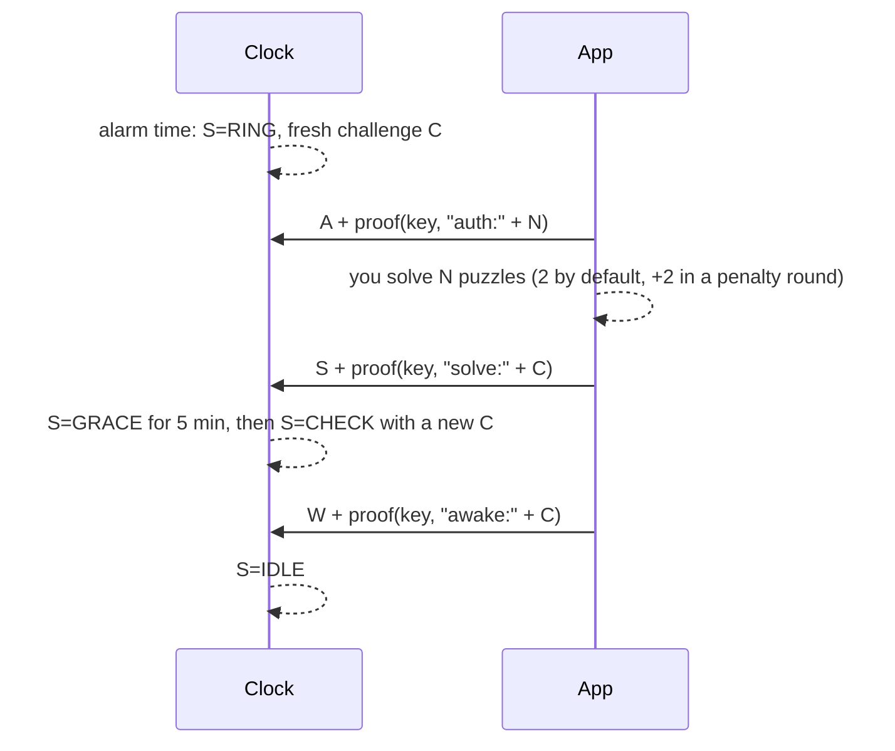

# Crow Bluetooth protocol

The clock is a BLE peripheral named `Crow-XXXX` (last 4 hex digits of its MAC). The app connects,
reads, and writes short text commands. Implementations: `firmware/crow/crow.ino` (clock),
`web/js/ble-link.js` + `web/js/app.js` (app), `web/js/sim-clock.js` (simulator), `web/js/proto.js` (shared).

## GATT

Service `c20a0000-0b5e-4d1e-9a1a-0000c20ac20a`

| Characteristic | UUID | Props | Value |
|----------------|------|-------|-------|
| State  | `c20a0001-…` | read, notify | State string (below). A notification only means "changed": it can be cut at the MTU, so the app re-reads the full value. |
| Command | `c20a0002-…` | write | One command per write, ≤ 20 bytes. |
| Key | `c20a0003-…` | read | 32 hex chars while pairing is open, empty otherwise. |
| Alarms | `c20a0004-…` | read | Four slots joined by `;`. Slot = `HHMM,mask,on` or empty. Mask bit 0 = Sunday … bit 6 = Saturday. |

## State string

`S=RING;L=2;C=a1b2…;N=…;T=1759820400;Z=-300;A=…;P=0;H=1;G=1;B=87;U=0;X=1;O=0;W=0;E=95;V=1;M=45;Y=2;Q=1;R=0;J=0;F=1.0.0`

| Key | Meaning |
|-----|---------|
| S | `NEW` (never paired), `IDLE`, `RING`, `GRACE` (silenced, waiting for wake check), `CHECK` (wake check running), `SOS` (count-off) |
| L | Ring level 0–3 |
| C | Current challenge (16 hex) during RING and CHECK, else empty |
| N | Session nonce (16 hex), new on every connection |
| T / Z | Clock time (unix, UTC) / timezone offset in minutes |
| A | Next alarm (unix, UTC), 0 if none |
| P | Pairing window open |
| H | Clock has a key |
| G | This connection is authenticated |
| B / U | Battery % / USB power present |
| X | Penalty round (+2 puzzles) |
| O | Orphaned: no authenticated check-in for 24 h |
| W | Seconds left in GRACE or CHECK |
| E | Seconds since this ring started |
| V / M | Wake check on / mercy limit in minutes |
| Y / Q / R | Betrayals / shames / SOS escapes (kept on the clock forever) |
| J | SOS round |
| F | Firmware version |

## Commands

| Cmd | Example | Needs | Effect |
|-----|---------|-------|--------|
| `A<proof>` | `A3f9c…` | key | Authenticate this connection. proof = P(key, `auth:` + N) |
| `S<proof>` | `S9ca9…` | key, state RING | Silence. proof = P(key, `solve:` + C) |
| `W<proof>` | | key, state CHECK | Pass the wake check. proof = P(key, `awake:` + C) |
| `P<proof>` | | pairing open | Accept the pending key. proof = P(pendingKey, `paired:` + N) |
| `M` | `M` | nothing | Wrong answer: bump the level (3 s cooldown) |
| `T<unix>,<tz>` | `T1759820400,-300` | auth | Set time + timezone |
| `L<slot>,<HHMM>,<mask>,<on>` | `L0,0700,127,1` | auth | Write an alarm slot. mask 0 clears it. |
| `C<wake>,<mercy>` | `C1,45` | auth | Wake check on/off, mercy minutes (5–120) |
| `R` | `R` | auth, IDLE | Test caw |

**P(key, msg)** = first 8 bytes of HMAC-SHA256(key, msg) as 16 lowercase hex characters.
Test vector: key `000102030405060708090a0b0c0d0e0f`, msg `solve:0011223344556677` → `9ca937f1f8b362d9`
(`npm test` checks this against Node's HMAC).

## Pairing

```mermaid
sequenceDiagram
  participant You
  participant Clock
  participant App
  App->>Clock: connect (new nonce N)
  You->>Clock: hold perch 3 s
  Clock-->>Clock: pendingKey = 16 random bytes, P=1 for 90 s
  App->>Clock: read Key characteristic
  App->>Clock: P + proof(pendingKey, "paired:" + N)
  Clock-->>Clock: key = pendingKey (old key dies; betrayals +1 if there was one; penalty if ringing)
  App-->>App: store key in app storage
```

## Silencing



## Threat model

The adversary is you, at 7 a.m., half asleep. Crow is built so the cheap escapes don't work:

| Escape | Result |
|--------|--------|
| Hit the button on top | There is no snooze. "NO SNOOZE". |
| Unplug it | Battery inside. Jumps to level 4. |
| Kill or mute the phone | The phone isn't making the noise. |
| Delete the app | The key goes with it. Alarms stay on the clock. Re-pair = penalty round + betrayal. |
| Replay last night's unlock | Every ring has a fresh random challenge. |
| A different phone | Pairing needs the perch hold and kills the old key, logged as a betrayal. |
| Phone lost or dead | SOS pin: five rounds of counting, awake-only by design. |

What it does not defend against: a screwdriver, a hammer, or a fully awake engineer pulling the battery.
If you are awake enough to do that, the alarm already worked. The key is readable by anyone in Bluetooth
range during the 90-second pairing window, which needs physical access to the perch anyway.
